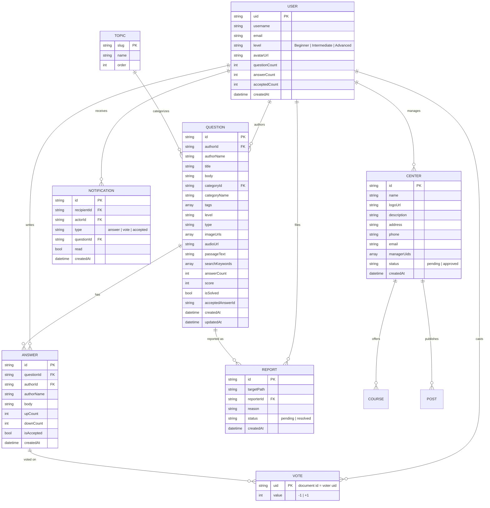

# EngQA

EngQA is an English-language discussion forum (a Reddit-style Q&A app) where learners post
questions, the community answers them, and answers can be voted on and accepted. This repository
contains the native Android client.

## Tech stack

| Layer      | Choice                                                                 |
|------------|------------------------------------------------------------------------|
| Language   | Java 11                                                                |
| UI         | XML layouts, `RecyclerView`, `ConstraintLayout`, Material 3            |
| Architecture | `model` / `data` (Repository) / `viewmodel` (ViewModel + LiveData) / `ui` |
| Backend    | Firebase Auth + Cloud Firestore (media also on Firestore, Base64)       |
| Media      | Glide, `MediaPlayer`, `MediaRecorder`; client compression/Base64; OkHttp + Gson |
| Background | `WorkManager` (offline posts, cache cleanup), `ExecutorService`          |
| Settings   | `PreferenceFragmentCompat` + `SharedPreferences`                        |
| Build      | Gradle (Kotlin DSL), `compileSdk 37`, `minSdk 29`                       |
| Theme      | Dark-only (`Theme.Material3.Dark.NoActionBar`)                         |

## Package layout

```
com.example.engqa
├── model      POJOs mapped to Firestore documents (User, Question, Answer, Vote,
│              Center, Course, CenterPost, Report, AppNotification, Category, UiState)
├── data       The only layer that talks to Firebase (UserRepository, QuestionRepository,
│              AnswerRepository, VoteRepository, StorageRepository, CategoryRepository,
│              CenterRepository, NotificationRepository, ReportRepository, ...)
├── viewmodel  Screen state, LiveData and listener lifecycle (AuthViewModel, HomeViewModel,
│              CreateQuestionViewModel, QuestionDetailViewModel, ProfileViewModel,
│              CenterViewModel, NotificationViewModel)
├── ui         RecyclerView adapters, the shared StateView and AudioPlayerView
├── media      ImageUtils, AudioPlayerManager, AudioRecorder, MediaCompressor,
│              MediaBudget, ThumbnailLoader
├── worker     WorkManager jobs: offline question queue, cache cleanup, scheduling
├── notification NotificationHelper (channel) and NotificationWatcher
├── util       Validators, TextUtils2 (search keywords), TimeUtils, PermissionHelper
└── *.java     Activities (one per screen) plus BaseNavActivity, SessionManager, NetworkUtils
```

The rule of thumb: **Activities never touch the Firebase SDK.** They observe `LiveData<UiState<T>>`
from a ViewModel and forward user input back through it. A screen renders exactly one of four
states — Loading, Success, Empty, Error(+Retry) — through the shared `StateView`.

## Firebase setup

> Step-by-step checklist for this project (`accountdata-dd29b`), including Firestore creation with
> the right region, rules/index deployment, seeding and acceptance checks:
> **[docs/FIREBASE_SETUP.md](docs/FIREBASE_SETUP.md)**.

1. Create a Firebase project and add an Android app with package name `com.example.engqa`.
2. Drop the generated `google-services.json` into `app/`.
3. Enable **Email/Password** sign-in, **Cloud Firestore** and **Cloud Storage**.
4. Deploy the security rules and indexes in this repository:

   ```bash
   firebase deploy --only firestore:rules,firestore:indexes,storage
   ```

5. Seed categories, demo accounts and sample content from the JSON datasets in
   `tools/seed/data/`. Two writers produce the same data — pick by credential:

   ```bash
   cd tools/seed

   # A) no key needed: reuses the `firebase login` session (Firestore REST + Identity Toolkit)
   node seed-rest.js --dry-run
   node seed-rest.js
   node seed-rest.js --no-auth   # Firestore only, when identitytoolkit is unreachable

   # B) Admin SDK, needs a service-account key
   npm install
   set GOOGLE_APPLICATION_CREDENTIALS=C:\path\to\serviceAccount.json
   npm run seed:dry
   npm run seed
   ```

   The datasets create 9 categories, 7 demo accounts (password `Engqa@1234`), 8 questions with
   answers and votes, and 2 centres. Every seeded document is flagged `isSample: true`. See
   `tools/seed/README.md` for the full data map.

6. To make an account an admin, create a document `admins/{uid}` in the Firebase Console. Client
   code can never write to `admins`, so admin status cannot be self-granted.

## Data model

A **question** is authored by one user and belongs to one category; it fans out to many **answers**.
Answers carry **votes** (one document per user per answer, so a user can only ever hold a single
vote) and the question owner can accept one answer. Denormalised counters (`answerCount`, `score`,
`upCount`, `downCount`) are updated inside transactions/batches so lists never need to join.

Regarding **search**: Firestore has no full-text search, so each question stores a
`searchKeywords` array (lower-case, accent-free, full tokens plus bounded prefixes of ≥ 2
characters). A query uses one bounded `array-contains-any` candidate lookup (up to 10 tokens,
including a few typo variants), then `SearchRanker` ranks the candidates locally: exact title and
phrase first, then title prefix/all-term, then body/tag/partial/fuzzy matches. The user's selected
sort is a tie-breaker, not a replacement for relevance. The same tokenizer is used by the app
(`TextUtils2`), the seed script, and `tools/seed/reindex-search.js`.

### ERD



Firestore collection paths:

```
users/{uid}
categories/{slug}
questions/{qid}
questions/{qid}/answers/{aid}
questions/{qid}/answers/{aid}/votes/{uid}
notifications/{id}
reports/{id}
centers/{cid}
centers/{cid}/courses/{id}
centers/{cid}/posts/{id}
admins/{uid}
```

## Authentication

Email/password sign-up and sign-in are fully implemented: unique display names, per-field
validation, password visibility toggles, loading states, specific Vietnamese error messages,
password reset, email verification (non-blocking, with resend), change-password and logout.
Registration atomically reserves `usernames/{exactDisplayName}` and creates `users/{uid}` in one
Firestore transaction. If the profile write fails transiently, the Auth account is kept so the next
login can complete it; it is rolled back only when the chosen username was already taken. Existing
profiles must be backfilled with `tools/seed/backfill-usernames.js` (13 reservations were created
for the current data), and **devices still running the old APK must install the new release** because
the old build uses a Firestore query that the current self-only profile rules correctly deny.

See **[docs/AUTH.md](docs/AUTH.md)** for the flow diagrams, validation rules, error-code mapping
and the manual test checklist. Auth depends on `firestore.rules`; see
[docs/FIREBASE_SETUP.md](docs/FIREBASE_SETUP.md) to deploy it. For Google Sign-In on a release build,
register the release SHA-1/SHA-256 in Firebase/Google Cloud and regenerate `google-services.json`;
the current file has no certificate hash and the release APK is unsigned until `keystore.properties`
is provided.

## Centre advertising (promos)

Centres can publish promotional posts (course, event, scholarship, announcement) that the home feed
interleaves with questions (one promo after every two questions). Posts are created as `PENDING` and
only appear once an administrator approves them; the `promos` collection is separate from
`questions`, so the Q&A feed is never diluted. A dedicated **Trung tâm** chip shows promos only.

The detail screen counts one view per opening (even across rotation), opens the website/phone through
implicit intents, saves posts locally with Room, and collects consultation requests at
`promos/{id}/leads/{uid}` (one per learner, enforced in a transaction). `users.role` / `users.centerId`
are granted by administrators only, and the security rules enforce approval and bounded counters.

See **[docs/PROMO.md](docs/PROMO.md)** for the data model, file map, rules and test checklist.

## Screens

| Screen                     | Layout                        | Activity                  |
|----------------------------|-------------------------------|---------------------------|
| Login / register / level   | `activity_login.xml`, `activity_register.xml`, `activity_choose_level.xml` | `LoginActivity`, `RegisterActivity`, `ChooseLevelActivity` |
| Home / question feed       | `activity_home.xml` + `layout-land/` | `HomeActivity`     |
| Ask a question             | `activity_main.xml` + `layout-land/` | `MainActivity`     |
| Question detail            | `activity_question_detail.xml`| `QuestionDetailActivity`  |
| Full-screen image          | `activity_image_viewer.xml`   | `ImageViewerActivity`     |
| Profile                    | `activity_menu_screen.xml`    | `MenuScreenActivity`      |
| Edit profile               | `activity_edit_profile.xml`   | `EditProfileActivity`     |
| Notifications              | `activity_notification.xml`   | `NotificationActivity`    |
| Centres                    | `activity_center_list.xml`, `activity_center_detail.xml`, `activity_center_edit.xml`, `activity_center_request.xml` | `CenterListActivity`, `CenterDetailActivity`, `CenterEditActivity`, `CenterRequestActivity` |
| Promo detail               | `activity_promo_detail.xml`   | `PromoDetailActivity`     |
| Create promo               | `activity_create_promo.xml`   | `CreatePromoActivity`     |
| Saved promos (Room)        | `activity_saved_promos.xml`   | `SavedPromosActivity`     |
| Consultation dialog        | `dialog_lead.xml`             | `LeadDialogFragment`      |
| Settings                   | `activity_settings.xml`, `xml/preferences.xml` | `SettingsActivity` / `SettingsFragment` |
| Word of the Day detail     | `activity_word_detail.xml`    | `WordDetailActivity`      |
| Can't connect to the server| `activity_server_error.xml`   | `ServerErrorActivity`     |

The bottom navigation bar is shared (`view_bottom_nav.xml`, `BaseNavActivity`) and has three tabs:
Home, Ask, Profile.

## Learning extras and background work

- **Media (Firestore-only)**: images are compressed to ≤1024 px and audio to AAC mono 24 kbps /
  120 s, then stored as Base64 documents under `questions/{qid}/media/*`; the feed uses a small
  `thumbBase64` thumbnail. Budgets and trade-offs: [docs/MEDIA_STORAGE.md](docs/MEDIA_STORAGE.md).
- **Settings** (`PreferenceFragmentCompat`): notification switch (requesting
  `POST_NOTIFICATIONS`), clear cache, about and logout. Values live in `SharedPreferences`.
- **Word of the Day**: a third feed view type (`FeedItem.TYPE_WORD`). `WordRepository` requests
  `dictionaryapi.dev` with OkHttp, parses JSON with Gson, caches today's entry in
  `SharedPreferences`, and `WordDetailActivity` renders all meanings, examples and pronunciation
  audio (cache-first, so it still works offline after the first fetch).
- **Offline posts** (`WorkManager`): when the device is offline, the question and its media are
  copied into internal storage and queued with a `NetworkType.CONNECTED` constraint. On reconnect
  the worker uploads the files, writes the question, posts a notification and sends an in-app
  broadcast that refreshes the open feed.
- **Cache cleanup** (`WorkManager`): a daily periodic worker deletes cached images/audio older
  than seven days.

## Rotation and state

Every screen keeps its state in a `ViewModel`, so a configuration change does not reload data or
create a duplicate Firestore listener (the listener is attached in `onStart` and detached in
`onStop`, and `onCleared` guarantees cleanup). The draft on the "Đặt câu hỏi" screen is kept in its
ViewModel and mirrored into `onSaveInstanceState` so it also survives process death. The profile
tab selection and the level chosen on `ChooseLevelActivity` are also saved across recreation, and
detail scroll views have IDs so their position is restored.

All activities use `screenOrientation="fullSensor"`; no `configChanges` shortcut is used, and no
activity is locked to portrait or landscape. Automatic sensor rotation was verified on the API 29
emulator through portrait → landscape → reverse portrait → reverse landscape → portrait
(`0 → 3 → 2 → 1 → 0`), with the correct layout loaded at each step. Home and
the Ask screen have dedicated `layout-land` variants, `ChooseLevelActivity` switches to a compact
horizontal card row in landscape, and the offline error screen uses a side-by-side illustration
instead of a 277dp vertical stack. Auth and form screens use `values-land/dimens.xml` to widen the
side gutters (96dp auth / 64dp forms) so fields do not stretch across a landscape phone. The Home
category chips remain one horizontally scrollable row in both orientations; a 2-column grid inside
the short landscape rail used to clip the lower categories.

## Build and test

```bash
./gradlew assembleDebug             # build the APK
./gradlew installDebug              # install on a connected device
./gradlew testDebugUnitTest         # JVM unit tests
./gradlew lintDebug                 # lint (must stay green)
./gradlew assembleDebugAndroidTest  # compile Espresso tests
./gradlew connectedDebugAndroidTest # run Espresso (requires an emulator)
```

Unit tests cover the pure-Java helpers: `TextUtils2` (accent/whitespace normalisation, prefixes,
query tokens, typo variants), `SearchRanker` (relevance, tie-breakers, filtering, promo ranking),
`Validators` (email/password/title and media limits), `TimeUtils` (relative-time labels),
`FeedMixer` (feed interleaving, expiry and promo search), `PromoValidator` (promo form rules),
`AnswerRanking` (Reddit-style ordering) and `PendingQuestionDraft` (Gson round-trip) —
**69 tests in total**. Instrumented tests cover login/register validation, the Settings
preferences and the cached Word detail.

## Release and distribution

A **release-signed** build is what makes every user's device work, because Google Sign-In is
tied to the app's signing certificate. Create one keystore, put its details in the git-ignored
`keystore.properties` (see `keystore.properties.example`), build `bundleRelease` / `assembleRelease`,
register its SHA-1 once with `node tools/fix-google-signin.js <sha1>` and ship that build.
Play App Signing needs its own SHA-1 registered as well.

Full checklist (keystore creation, signing, Play App Signing, API-key restrictions, clean-device
verification and distribution options): **[docs/RELEASE.md](docs/RELEASE.md)**.

## Team work split

The repository is divided into four non-overlapping work packages — **Auth & Profile**, **Q&A core**,
**Feed / Promos / Centres**, and **Platform / Infra / QA** — so each person commits only their own
files. See **[docs/TEAM_DIVISION.md](docs/TEAM_DIVISION.md)** for the exact file list per person,
the shared-file protocol and the Git conventions. `docs/CODEOWNERS.template` becomes
`.github/CODEOWNERS` once the GitHub usernames are filled in.

## Security rules

`firestore.rules` and `storage.rules` are deployed from this repository (`storage.rules` only
applies when Firebase Storage is enabled; see [docs/MEDIA_STORAGE.md](docs/MEDIA_STORAGE.md)).

- A question may only be created with `authorId == request.auth.uid`.
- An answer starts with zero counters and `isAccepted == false`; only the question owner may accept.
- Votes are one document per user per answer (`votes/{uid}`) with `value` in `{+1, -1}`.
  Answers show a **net score** (up minus down, which can be negative) and are ordered highest
  first, Reddit-style, with accepted/newest as tie-breakers.
- Notifications can only be created for someone else and read only by their recipient.
- Promos are readable only when `APPROVED`; creation requires the `CENTER` role linked to the
  promo's centre, `status == 'PENDING'` and zero counters. Counter bumps are capped at +1.
- A learner can create only their own lead (`promos/{id}/leads/{uid}`); the centre and admins read it.
- `users.role`/`users.centerId` cannot be changed by the user; admins are added from the Console.
- `admins` is read-only from clients.

## Known limitations

- **Notifications** are delivered by a Firestore listener (`NotificationWatcher`) while the app
  process is alive. A fully reliable push (background/killed app) needs Firebase Cloud Messaging,
  which is out of scope for this phase.
- **Vote integrity** is enforced by rules only at a coarse level (document id + allowed values).
  A production build would move the counter updates into a Cloud Function or add `getAfter()`
  delta checks.
- **Search** retrieves at most 60 candidates with one `array-contains-any` query and ranks them
  locally. It supports accent/case/whitespace-insensitive multi-word queries, title/body/tag
  prefixes, and common one-character typos (extra/missing/transposed/substituted characters) via
  deletion/transposition variants plus a short-prefix fallback. It is not a full-text engine:
  results beyond the bounded candidate set and typos in the first characters of short tokens are
  not covered; a dedicated search service would be required at much larger scale.
- **Media storage** is Firestore-only because Cloud Storage requires Blaze: each item is a Base64
  document capped at 600 000 chars (≤450 KB binary), audio is limited to ~120 s and 5 images per
  question. This keeps the free Spark plan but consumes Firestore's 1 GiB storage — see
  [docs/MEDIA_STORAGE.md](docs/MEDIA_STORAGE.md).
