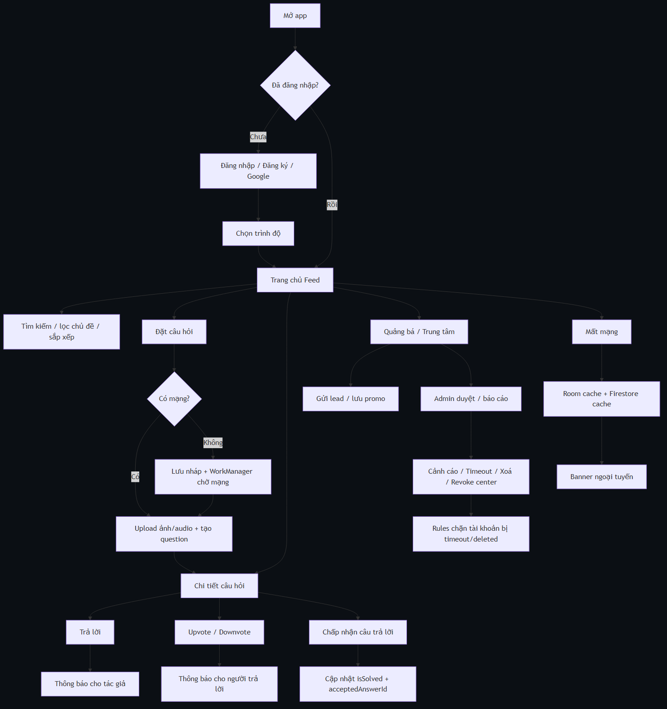
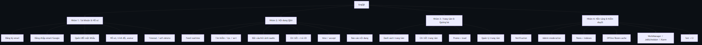
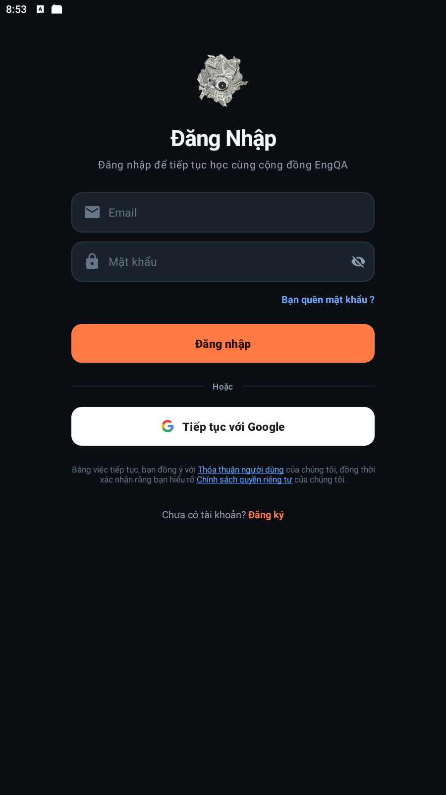
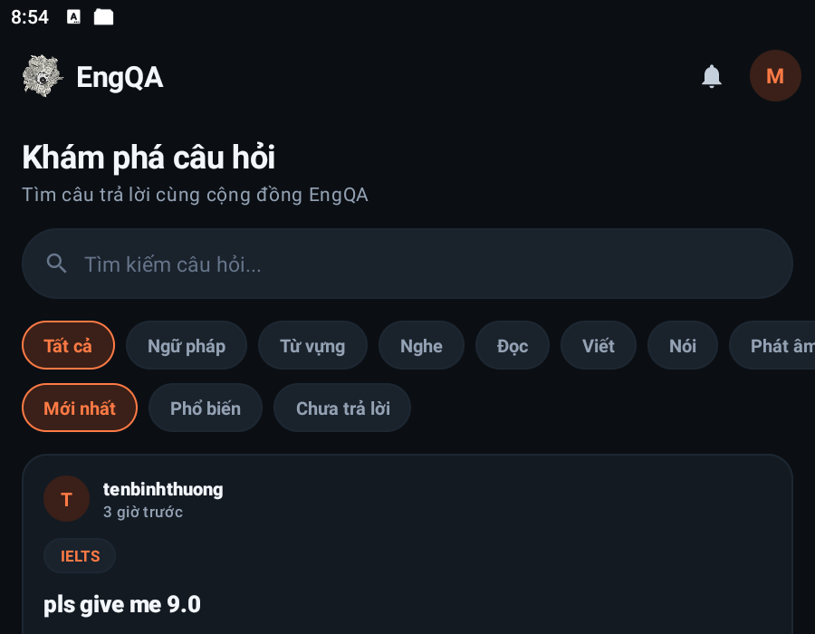
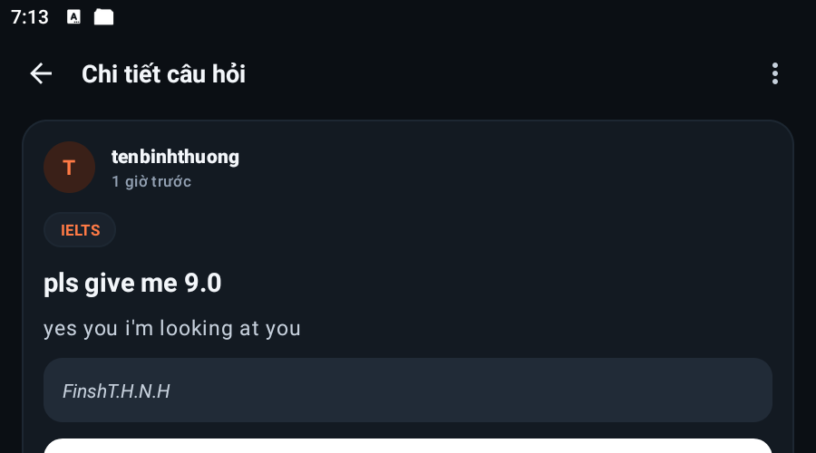
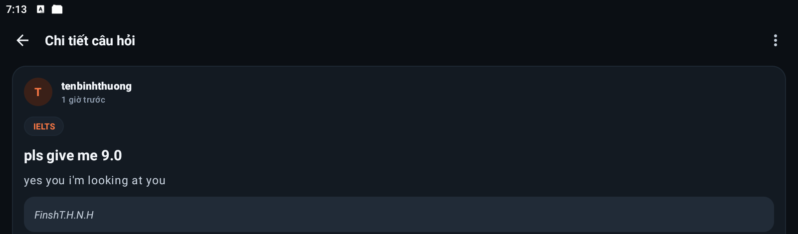
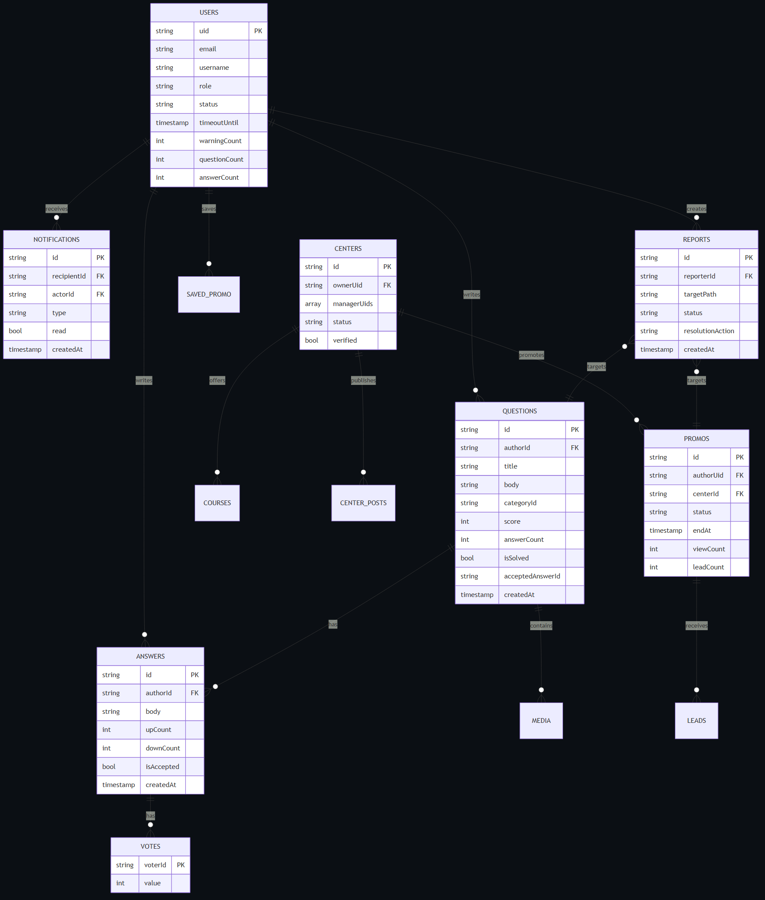
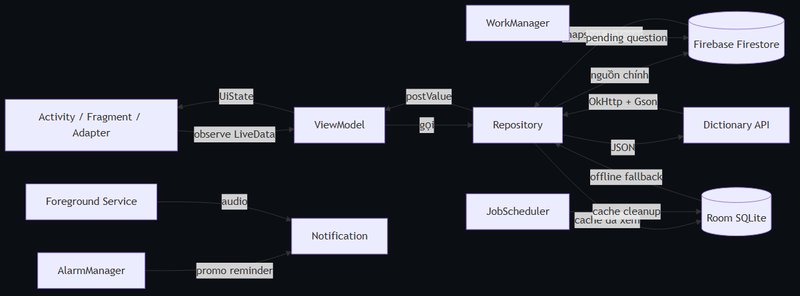
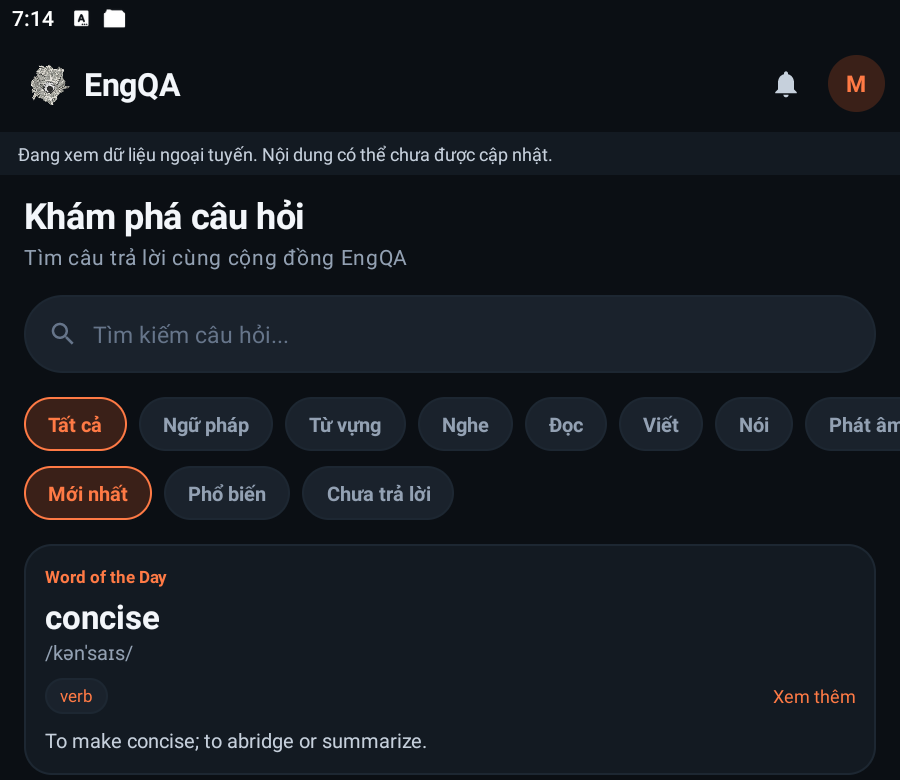

<div class="cover">

<p class="cover-university">TRƯỜNG ĐẠI HỌC KINH TẾ THÀNH PHỐ HỒ CHÍ MINH</p>
<p class="cover-faculty">KHOA CÔNG NGHỆ THÔNG TIN</p>

<div class="cover-mark">ENGQA</div>

<h1 class="cover-title">XÂY DỰNG ỨNG DỤNG DI ĐỘNG ENGQA</h1>
<p class="cover-subtitle">NỀN TẢNG HỎI ĐÁP TIẾNG ANH VÀ QUẢNG BÁ TRUNG TÂM</p>

<table class="cover-table">
<tr><td>Môn học</td><td>Phát triển ứng dụng di động</td></tr>
<tr><td>Giảng viên hướng dẫn</td><td>............................................................</td></tr>
<tr><td>Nhóm thực hiện</td><td>Nhóm EngQA</td></tr>
<tr><td>Thành viên</td><td>Thịnh · Bảo · Phú · Đăng</td></tr>
<tr><td>Thời gian</td><td>Tháng 10/2026</td></tr>
</table>

<p class="cover-note">Báo cáo đồ án · Phiên bản 1.0 · Mã nguồn: MOB-EngQA</p>
</div>

<div class="page-break"></div>

# MỤC LỤC

1. [CHƯƠNG 1. TỔNG QUAN](#chuong-1)
2. [CHƯƠNG 2. PHÂN TÍCH VÀ THIẾT KẾ HỆ THỐNG](#chuong-2)
3. [CHƯƠNG 3. THIẾT KẾ GIAO DIỆN](#chuong-3)
4. [CHƯƠNG 4. XÂY DỰNG CƠ SỞ DỮ LIỆU](#chuong-4)
5. [CHƯƠNG 5. XÂY DỰNG ỨNG DỤNG](#chuong-5)
6. [CHƯƠNG 6. QUY TRÌNH THỰC THI](#chuong-6)
7. [CHƯƠNG 7. KIỂM THỬ, ĐÁNH GIÁ VÀ PHÂN CÔNG](#chuong-7)
8. [CHƯƠNG 8. HƯỚNG MỞ RỘNG](#chuong-8)
9. [PHỤ LỤC](#phu-luc)
10. [TÀI LIỆU THAM KHẢO](#tai-lieu-tham-khao)

**Danh mục hình**

- Hình 2.1. Sơ đồ luồng công việc của EngQA
- Hình 2.2. Sơ đồ phân rã chức năng
- Hình 4.1. Mô hình thực thể Firestore
- Hình 5.1. Kiến trúc Activity – ViewModel – Repository – Firestore/Room
- Hình 3.1. Màn hình đăng nhập
- Hình 3.2. Trang chủ feed
- Hình 3.3. Chi tiết câu hỏi
- Hình 3.4. Chi tiết câu hỏi ở chế độ ngang
- Hình 3.5. Trang chủ khi mất mạng (Room/Firestore cache)

**Danh mục bảng**

- Bảng 2.1. Tác nhân và use case
- Bảng 4.1. Các collection Firestore
- Bảng 4.2. Truy vấn tiêu biểu
- Bảng 5.1. Cấu trúc package
- Bảng 6.1. Ma trận kiểm duyệt
- Bảng 7.1. Kết quả kiểm thử
- Bảng 7.2. Đối chiếu 25 lỗi audit
- Bảng 7.3. Phân công và mức độ hoàn thành

<div class="page-break"></div>

# DANH MỤC TỪ VIẾT TẮT

| Từ viết tắt | Diễn giải |
|---|---|
| API | Application Programming Interface |
| CRUD | Create – Read – Update – Delete |
| DAO | Data Access Object |
| ERD | Entity Relationship Diagram |
| FCM | Firebase Cloud Messaging |
| MVVM | Model – View – ViewModel |
| SDK | Software Development Kit |
| UI/UX | User Interface / User Experience |
| JSON | JavaScript Object Notation |
| Room | Thư viện ORM/SQLite của Android Jetpack |

<div class="page-break"></div>

<a id="chuong-1"></a>
# CHƯƠNG 1. TỔNG QUAN

## 1.1. Giới thiệu

EngQA là ứng dụng di động hỗ trợ cộng đồng học tiếng Anh theo mô hình hỏi đáp (Q&A) kết hợp quảng bá trung tâm. Người học có thể đặt câu hỏi kèm ảnh, đoạn văn hoặc âm thanh; cộng đồng trả lời, bình chọn và chấp nhận câu trả lời đúng. Các trung tâm tiếng Anh có thể tạo hồ sơ, đăng khóa học, đăng bài và gửi chương trình quảng bá; người học có thể lưu bài quảng bá hoặc để lại thông tin tư vấn.

Ứng dụng được xây dựng bằng Java, XML và Android SDK, sử dụng Firebase Authentication và Cloud Firestore làm nền tảng dữ liệu thời gian thực. Giao diện theo Material 3, tối ưu cho màn hình điện thoại, có bố cục thay thế khi xoay ngang và có bộ nhớ đệm ngoại tuyến.

## 1.2. Tính cấp thiết của đề tài

Việc học tiếng Anh thường gặp ba khó khăn: (1) người học cần phản hồi nhanh cho câu hỏi ngữ pháp, từ vựng, phát âm; (2) nội dung học phân tán trên nhiều nhóm mạng xã hội, khó tìm lại; (3) thông tin trung tâm quảng bá thiếu kiểm chứng và dễ bị spam. EngQA gom ba nhu cầu này vào một ứng dụng:

- **Hỏi đáp có cấu trúc**: câu hỏi theo chủ đề, trình độ, có ảnh/âm thanh, có vote và câu trả lời được chấp nhận.
- **Nội dung có kiểm duyệt**: báo cáo nội dung, cảnh cáo, timeout, xoá nội dung và thu hồi quyền trung tâm.
- **Quảng bá có kiểm soát**: trung tâm phải được admin duyệt; promo chỉ hiển thị công khai sau khi duyệt.

Với đồ án môn học, mục tiêu không phải xây dựng sản phẩm thương mại hoàn chỉnh mà là chứng minh năng lực vận dụng kiến trúc Android, Firebase, responsive, offline, background work và kiểm thử.

## 1.3. Công cụ phát triển ứng dụng di động

### a) Java

Java là ngôn ngữ chính của dự án. Các lớp được tổ chức theo hướng đối tượng: `Activity` cho vòng đời màn hình, `ViewModel` cho trạng thái, `Repository` cho truy cập dữ liệu, POJO trong `model/` cho Firestore. Java 11 được cấu hình trong Gradle; mã chạy trên Android runtime thông qua D8/ART.

### b) Android SDK

Ứng dụng dùng `minSdk 29`, `targetSdk 37` (theo cấu hình hiện tại). Các thành phần chính:

- **Activity/XML**: mỗi màn hình là một Activity, giao diện khai báo bằng XML.
- **RecyclerView + Adapter/ViewHolder**: feed, câu trả lời, thông báo, danh sách admin.
- **Room**: lưu promo đã lưu và cache nội dung đã xem.
- **WorkManager**: đăng câu hỏi đang chờ khi có mạng.
- **JobScheduler**: dọn cache định kỳ.
- **AlarmManager + BroadcastReceiver**: nhắc promo sắp hết hạn, khôi phục sau reboot.
- **Foreground Service + Notification**: phát audio trong nền.
- **Material 3**: theme tối, màu nhấn cam, typography thống nhất.

### c) Android Studio

Android Studio cung cấp Layout Editor, Logcat, Device Manager và Gradle. Trong quá trình làm, nhóm dùng Android Studio emulator và thiết bị Samsung SM-S908E (API 30) để kiểm tra xoay màn hình, offline, notification và background work. Các lệnh kiểm thử chính:

```text
.\gradlew.bat assembleDebug
.\gradlew.bat testDebugUnitTest
.\gradlew.bat connectedDebugAndroidTest
.\gradlew.bat lintDebug
```

### d) Firebase

- **Firebase Authentication**: đăng ký/đăng nhập email, Google Sign-In, đổi/ quên mật khẩu.
- **Cloud Firestore**: lưu người dùng, câu hỏi, câu trả lời, vote, trung tâm, promo, báo cáo, thông báo.
- **Firestore Security Rules**: ranh giới bảo mật thực sự; client chỉ hiển thị lỗi.
- **Firestore Indexes**: các composite index cho feed, tìm kiếm, thông báo.
- **Firestore Persistence**: cache của SDK, kết hợp Room cache của ứng dụng.

> Luồng upload media hiện tại được giữ nguyên theo yêu cầu: chọn ảnh/âm thanh → nén/kiểm tra → lưu theo cơ chế hiện có của dự án. Báo cáo này không thay đổi cách upload; các phần mới chỉ liên quan đến phát audio nền, cache đọc, rules và kiểm thử.

## 1.4. Kiểm thử ứng dụng trên Android emulator và thiết bị

Nhóm kiểm thử theo bốn lớp:

1. **Unit test** (JUnit): logic thuần như validator, xếp hạng câu trả lời, moderation policy, media budget.
2. **Instrumentation test** (Espresso/Room): đăng nhập, đăng ký, Settings, màn tài khoản bị chặn, cache Room.
3. **Rules test** (Firestore Emulator + `@firebase/rules-unit-testing`): quyền đọc/ghi, timeout, notification, report.
4. **Kiểm thử thủ công**: xoay 4 hướng, mất mạng, phát audio nền, alarm, JobScheduler, admin.

Kết quả chi tiết ở Chương 7.

<div class="page-break"></div>

<a id="chuong-2"></a>
# CHƯƠNG 2. PHÂN TÍCH VÀ THIẾT KẾ HỆ THỐNG

## 2.1. Sơ đồ luồng công việc (workflow diagram)


<p class="fig">Hình 2.1. Sơ đồ luồng công việc của EngQA</p>

Luồng chính gồm: mở app → xác thực → feed → đặt câu hỏi/trả lời/vote/accept → quảng bá và kiểm duyệt. Nhánh offline cho phép lưu nháp và đăng lại khi có mạng; nhánh cache cho phép xem lại nội dung đã tải.

## 2.2. Sơ đồ phân rã chức năng (business functional diagram)


<p class="fig">Hình 2.2. Sơ đồ phân rã chức năng</p>

Hệ thống được chia thành bốn nhóm chức năng:

1. **Tài khoản và hồ sơ**: đăng ký, đăng nhập, Google, quên/đổi mật khẩu, chọn trình độ, avatar, trạng thái timeout/soft-delete.
2. **Nội dung Q&A**: feed, tìm kiếm/lọc/sắp xếp, đặt câu hỏi đa phương tiện, chi tiết, trả lời, vote, chấp nhận câu trả lời, báo cáo.
3. **Trung tâm và quảng bá**: danh sách/chi tiết trung tâm, khóa học, bài đăng, promo, lead, quản lý trung tâm.
4. **Nền tảng**: thông báo, kiểm duyệt admin, rules/indexes, cache offline, background work, kiểm thử.

## 2.3. Tác nhân và use case

| Tác nhân | Use case chính |
|---|---|
| Khách chưa đăng nhập | Đăng ký, đăng nhập, xem promo/trung tâm đã duyệt (nếu cho phép) |
| Người học | Feed, tìm kiếm, đặt câu hỏi, trả lời, vote, accept, lưu promo, gửi lead, báo cáo, quản lý hồ sơ |
| Quản lý trung tâm | Tạo hồ sơ trung tâm, chờ duyệt, sửa hồ sơ, đăng khóa học/bài viết, tạo promo |
| Admin | Duyệt/từ chối trung tâm và promo, xử lý báo cáo, cảnh cáo/timeout/xoá nội dung, thu hồi trung tâm |
| Hệ thống | Rules, notification, cache cleanup, alarm, offline queue |

## 2.4. Yêu cầu phi chức năng

- **Responsive**: không khoá hướng; layout-land cho các màn chính; điều chỉnh padding theo `values-land`, `values-sw600dp`.
- **Offline**: Firestore persistence + Room cache; banner ngoại tuyến; hàng đợi đăng câu hỏi.
- **Bảo mật**: rules là nguồn quyết định; client không được tự tăng counter, không được tạo notification giả, không được tự duyệt trung tâm/promo.
- **Hiệu năng**: phân trang, listener được gỡ khi ViewModel cleared, xử lý nặng trên executor.
- **Khả năng bảo trì**: package rõ ràng, repository là nơi duy nhất dùng Firebase SDK.

<div class="page-break"></div>

<a id="chuong-3"></a>
# CHƯƠNG 3. THIẾT KẾ GIAO DIỆN

## 3.1. Hệ thống thiết kế

Ứng dụng dùng theme tối với ba lớp màu: nền `#0B0F14`, card `#131A22`, input `#1A222C`; màu nhấn cam `#FF6B35` dùng cho hành động chính và trạng thái đang chọn. Chữ chính màu trắng ngà, chữ phụ xám xanh. Các nguyên tắc:

- Một hành động chính mỗi màn (đăng nhập, gửi câu hỏi, gửi câu trả lời).
- Card bo góc, khoảng cách 12–16dp, đường viền mảnh.
- Bottom navigation 3 mục: Trang chủ, Đặt câu hỏi, Cá nhân.
- Touch target tối thiểu 48dp; icon có `contentDescription`.
- Trạng thái loading/empty/error dùng chung `StateView` với nút “Thử lại”.

## 3.2. Đăng nhập, đăng ký, Google


<p class="fig">Hình 3.1. Màn hình đăng nhập</p>

Màn đăng nhập gồm email, mật khẩu, quên mật khẩu, đăng nhập, Google và liên kết đăng ký. Mật khẩu có nút hiện/ẩn; lỗi hiển thị ngay dưới trường. Tài khoản Google được phát hiện qua `providerData`; ứng dụng không hiển thị đổi mật khẩu mà hướng người dùng sang trang quản lý của Google.

Luồng đăng ký kiểm tra email, độ mạnh mật khẩu, tên hiển thị duy nhất; sau khi tạo Auth, ứng dụng ghi `users/{uid}` và reservation username trong transaction. Nếu ghi profile lỗi, tài khoản Auth được giữ để có thể đăng nhập lại và bổ sung sau.

## 3.3. Trang chủ, tìm kiếm, lọc và sắp xếp


<p class="fig">Hình 3.2. Trang chủ feed</p>

Trang chủ gồm:

- Logo, chuông thông báo có badge, avatar.
- Ô tìm kiếm.
- Dải chip chủ đề (Tất cả, Ngữ pháp, Từ vựng, Nghe, Đọc, Viết, Nói, Phát âm, IELTS, TOEIC).
- Chip sắp xếp: Mới nhất, Phổ biến, Chưa trả lời.
- Card “Word of the Day” lấy từ Dictionary API qua OkHttp + Gson, có cache theo ngày.
- Feed câu hỏi: avatar, tên, thời gian, tag, tiêu đề, ảnh, số vote/câu trả lời.

Tìm kiếm dùng `searchKeywords` (đã bỏ dấu, tách từ) và `arrayContainsAny`; kết quả được xếp hạng ở client bằng `SearchRanker`. Khi mất mạng, repository trả cache Room và UI hiện banner.

## 3.4. Chi tiết câu hỏi, trả lời, vote và media


<p class="fig">Hình 3.3. Chi tiết câu hỏi</p>

Màn chi tiết hiển thị câu hỏi, đoạn văn, ảnh, audio, danh sách câu trả lời và ô nhập câu trả lời. Ảnh giữ đúng tỉ lệ, bấm để mở `ImageViewerActivity` (pinch-to-zoom). Audio có nút play/pause, thanh tiến trình và nút “Nền” để phát qua foreground service.

Câu trả lời được sắp xếp theo accepted trước, sau đó theo điểm và thời gian. Vote dùng transaction: một document `votes/{uid}` cho mỗi người, cập nhật `upCount`, `downCount` và `score` tuyệt đối để tránh trôi counter. Accept cập nhật `isAccepted` của câu trả lời, `isSolved` và `acceptedAnswerId` của câu hỏi trong cùng transaction.

## 3.5. Hồ sơ, cài đặt và promo

- **Hồ sơ**: header avatar/tên/trình độ, thống kê câu hỏi/câu trả lời/accepted, tab câu hỏi và câu trả lời của tôi, đăng xuất.
- **Cài đặt**: thông báo, tài khoản & bảo mật, giao diện, dữ liệu, giới thiệu. Dùng `PreferenceFragmentCompat`.
- **Promo**: danh sách, chi tiết, lưu offline, gửi lead, mở website/gọi điện, báo cáo. Promo đã duyệt mới công khai.
- **Trung tâm**: danh sách/chi tiết, khóa học, bài đăng; quản lý trung tâm sau khi được duyệt.

## 3.6. Admin theo hướng mobile

Admin hiện có màn danh sách báo cáo/trung tâm/promo, duyệt hoặc từ chối, cảnh cáo, timeout, xoá nội dung và thu hồi trung tâm. Các thao tác nguy hiểm đều có hộp thoại xác nhận; kết quả được ghi audit log và gửi notification cho người bị xử lý. Định hướng tiếp theo là chuyển hành động sang bottom sheet và thêm badge/pagination để thao tác một tay tốt hơn.

## 3.7. Responsive và xoay màn hình

Manifest không còn `android:screenOrientation`; hệ thống tự quyết định hướng. Các bố cục thay thế:

- `layout-land/activity_home.xml`: feed + rail danh mục.
- `layout-land/activity_question_detail.xml`, `activity_menu_screen.xml`: bản ngang.
- `values-land/dimens.xml`: giảm/điều chỉnh padding form.
- `values-sw600dp/dimens.xml`, `values-sw900dp`: giới hạn chiều rộng form trên tablet.


<p class="fig">Hình 3.4. Chi tiết câu hỏi ở chế độ ngang</p>

Khi xoay, Activity được tạo lại nhưng dữ liệu nằm trong ViewModel và listener được gỡ/đăng ký đúng vòng đời, nên không mất trạng thái và không nhân đôi listener.

## 3.8. Khả năng tiếp cận

- Touch target chính ≥48dp (nút play audio đã tăng từ 40dp lên 48dp).
- Icon có `contentDescription`; text có contrast trên nền tối.
- Form dùng `ScrollView`/`NestedScrollView`, `windowSoftInputMode="adjustResize"`.
- Lint còn 279 warning (chủ yếu hardcoded string, typography, resource), 0 error; đây là phần tiếp tục cải thiện.

<div class="page-break"></div>

<a id="chuong-4"></a>
# CHƯƠNG 4. XÂY DỰNG CƠ SỞ DỮ LIỆU

## 4.1. Mô hình dữ liệu Firestore

EngQA dùng Firestore (NoSQL) thay vì SQL Server/MySQL. Mỗi collection là một tập document; quan hệ được thể hiện bằng id tham chiếu và subcollection.

| Collection | Khóa | Trường chính | Ghi chú |
|---|---|---|---|
| `users` | `uid` | email, username, level, role, status, timeoutUntil, warningCount, questionCount, answerCount, avatarUrl | `status`: ACTIVE/TIMEOUT/DELETED |
| `questions` | auto id | authorId, title, body, categoryId, tags, level, type, passageText, imageUrls, audioUrl, searchKeywords, score, answerCount, isSolved, acceptedAnswerId, createdAt, updatedAt | feed, tìm kiếm |
| `questions/{id}/answers` | auto id | authorId, body, upCount, downCount, isAccepted, createdAt | subcollection |
| `questions/{id}/answers/{id}/votes` | `uid` | value (±1) | một vote/người/câu trả lời |
| `questions/{id}/media` | auto id | mime, data (Base64), createdAt | **giữ nguyên cơ chế upload hiện tại** |
| `notifications` | auto id | recipientId, actorId, type, questionId, answerId, promoId, centerId, title, body, read, createdAt | in-app |
| `centers` | auto id | ownerUid, managerUids, name, description, status, verified | duyệt bởi admin |
| `centers/{id}/courses` | auto id | title, description, level, fee | quản lý trung tâm |
| `centers/{id}/posts` | auto id | title, body, createdAt | quản lý trung tâm |
| `centerRequests` | `uid` | status, centerId | marker một yêu cầu/người |
| `promos` | auto id | authorUid, centerId, title, body, type, level, fee, schedule, contactPhone, linkUrl, imageUrl, endAt, status, viewCount, clickCount, leadCount | duyệt bởi admin |
| `promos/{id}/leads` | `uid` | userUid, name, phone, note, status | một lead/người/promo |
| `reports` | `uid_hash(targetPath)` | reporterId, targetPath, reason, status, resolutionAction, resolutionNote, resolvedBy, resolvedAt | chống trùng |
| `admins` | `uid` | role | chỉ tạo thủ công/Console |
| `auditLogs` | auto id | adminId, action, target, note, createdAt | nhật ký admin |


<p class="fig">Hình 4.1. Mô hình thực thể Firestore</p>

## 4.2. Quan hệ và quy ước

- `questions.authorId` → `users.uid`.
- `answers.authorId` → `users.uid`; `answers` nằm dưới `questions/{id}`.
- `votes/{uid}` nằm dưới answer; document id chính là người vote nên không thể vote hai lần.
- `notifications.recipientId` → người nhận; `actorId` → người gây ra; `questionId`/`answerId`/`promoId`/`centerId` là deep link.
- `promos.centerId` → `centers.id`; `leads/{uid}` nằm dưới promo.
- `reports.targetPath` là chuỗi `questions/{id}` hoặc `promos/{id}`.

Quy ước thời gian: `createdAt`, `updatedAt`, `resolvedAt` dùng `FieldValue.serverTimestamp()`; rule so sánh timeout với `request.time`, không tin đồng hồ thiết bị.

## 4.3. Truy vấn tiêu biểu

| Mục đích | Truy vấn |
|---|---|
| Feed mới nhất | `questions` + `where categoryId` + `orderBy createdAt desc` + `limit 10` |
| Feed phổ biến | `questions` + `where categoryId` + `orderBy score desc, createdAt desc` + `limit 10` |
| Chưa trả lời | `questions` + `where answerCount == 0` + `orderBy createdAt desc` |
| Tìm kiếm | `questions` + `where searchKeywords arrayContainsAny tokens` + `orderBy score/createdAt` |
| Câu trả lời | `questions/{id}/answers` + `orderBy isAccepted desc, createdAt asc` |
| Vote của tôi | `questions/{id}/answers/{aid}/votes/{uid}` |
| Thông báo | `notifications` + `where recipientId == uid` + `orderBy createdAt desc` + `limit 100` |
| Promo đã duyệt | `promos` + `where status == APPROVED` + `orderBy createdAt desc` |
| Báo cáo admin | `reports` + `where status == pending` + `orderBy createdAt asc` |

Các composite index tương ứng nằm trong `firestore.indexes.json`, gồm index cho `questions` (category + createdAt, category + score, category + answerCount, searchKeywords + category + score/answerCount), `answers`, `notifications`, `centers`, `promos`.

## 4.4. Security Rules

Rules là lớp bảo vệ chính. Các nguyên tắc đã triển khai:

1. **Trạng thái tài khoản**: `isActive()` đọc `users/{uid}`; chặn `DELETED`; `TIMEOUT` chỉ được phép sau `timeoutUntil` so với `request.time`; admin bỏ qua.
2. **Chủ sở hữu nội dung**: câu hỏi chỉ được sửa các field nội dung; `authorId`, `score`, `answerCount`, `isSolved`, `acceptedAnswerId` không được sửa tùy tiện. Accept có nhánh riêng cho chủ câu hỏi.
3. **Counter**: `questionCount`/`answerCount` chỉ được tăng/giảm đúng 1; `upCount`/`downCount` thay đổi trong biên ±1; `acceptedCount` không cho client ghi.
4. **Notification**: type `answer` phải do người trả lời tạo, recipient là chủ câu hỏi, `answerId` tồn tại; type `vote` phải có vote thật; type `accepted` phải khớp `acceptedAnswerId`; type kiểm duyệt chỉ admin.
5. **Báo cáo**: id dạng `uid_hash(targetPath)`, một báo cáo pending/người/nội dung; chỉ admin được resolve.
6. **Trung tâm**: tạo trung tâm cần marker `centerRequests/{uid}`; manager không tự đổi `status/verified`; subcollection chỉ đọc khi trung tâm đã duyệt hoặc là manager/admin.
7. **Storage**: logo trung tâm chỉ admin/manager đã duyệt được ghi; avatar đúng uid; media câu hỏi đúng chủ câu hỏi.

Các rule được kiểm chứng bằng 12 test trên Firestore Emulator (xem Chương 7).

## 4.5. Bộ nhớ đệm Room

Ngoài Firestore persistence, ứng dụng có Room database `AppDatabase` version 3:

- `saved_promo`: promo đã lưu (có từ trước).
- `cached_question`: JSON câu hỏi + ownerUid + categoryId + createdAt/score/answerCount; khóa chính `(owner_uid, question_id)`.
- `cached_notification`: JSON thông báo + ownerUid + createdAt/read.

Cache được ghi khi listener Firestore trả dữ liệu; khi listener lỗi (mất mạng hoàn toàn), repository đọc cache và trả `Page(fromCache=true)`. Trang chủ hiện banner “Đang xem dữ liệu ngoại tuyến”. Cache giới hạn 7 ngày và được dọn bởi JobScheduler.

<div class="page-break"></div>

<a id="chuong-5"></a>
# CHƯƠNG 5. XÂY DỰNG ỨNG DỤNG

## 5.1. Cấu trúc ứng dụng

| Package | Thành phần chính | Trách nhiệm |
|---|---|---|
| `com.example.engqa` | Login, Register, Home, Main (đặt câu hỏi), QuestionDetail, Menu, Promo, Center, Admin, Settings | Activity, điều hướng |
| `model` | User, Question, Answer, Vote, Promo, Center, Report, AppNotification, UiState | POJO Firestore + trạng thái UI |
| `data` | UserRepository, QuestionRepository, AnswerRepository, VoteRepository, NotificationRepository, ReportRepository, CenterRepository, WordRepository, OfflineCache | Nơi duy nhất dùng Firebase/OkHttp/Room |
| `data/local` | AppDatabase, SavedPromo, CachedQuestion, CachedNotification, DAO | Room |
| `viewmodel` | AuthViewModel, FeedViewModel, QuestionDetailViewModel, AdminViewModel, NotificationViewModel, PromoViewModel | Trạng thái + gọi Repository |
| `ui` | FeedAdapter, AnswerAdapter, SearchRanker, StateView, AudioPlayerView | Adapter/View |
| `media` | AudioPlayerManager, AudioRecorder, ImageUtils, AudioPlaybackService | Media |
| `notification` | NotificationHelper, NotificationWatcher | Channel, hiển thị, deep link |
| `alarm` | PromoReminderScheduler, PromoReminderReceiver, BootReceiver | Alarm + reboot |
| `job` | CacheCleanupJobService | JobScheduler |
| `worker` | PendingQuestionWorker, WorkScheduler, PendingDraftStore | WorkManager offline queue |
| `util` | Validators, TextUtils2, TimeUtils, PrefsHelper, Navigation | Tiện ích |

Luồng phụ thuộc:


<p class="fig">Hình 5.1. Kiến trúc Activity – ViewModel – Repository – Firestore/Room</p>

Activity chỉ quan sát `LiveData`; ViewModel không giữ View/Activity; Repository trả `ListenerRegistration` và ViewModel gỡ trong `onCleared()`. Nhờ vậy xoay màn hình không nhân đôi listener.

## 5.2. Kết nối Firebase

Ứng dụng dùng `google-services.json` của project Firebase, khởi tạo trong `EngQAApp`:

- Bật `FirebaseFirestore.setFirestoreSettings` với `persistenceEnabled(true)`.
- Tạo NotificationChannel.
- Đăng ký `NotificationWatcher` để hiển thị thông báo in-app.
- Lên lịch `CacheCleanupJobService`.

Rules và indexes được deploy bằng Firebase CLI:

```text
firebase deploy --only firestore:rules,firestore:indexes
firebase deploy --only storage
```

`admins/{uid}` chỉ được tạo trong Console/Admin SDK; client không có quyền ghi.

## 5.3. Xây dựng nội dung các trang

### a) Trang đăng nhập/đăng ký

`LoginActivity` dùng `AuthViewModel` và `UserRepository`. Các bước:

1. Validate email/mật khẩu.
2. Gọi `signInWithEmailAndPassword` hoặc Google Sign-In.
3. Đọc `users/{uid}`; nếu chưa có profile thì tạo sau khi xác thực.
4. Chuyển Home hoặc ChooseLevel.

`RegisterActivity` kiểm tra username duy nhất bằng transaction trên `usernames/{name}` và `users/{uid}`. Mật khẩu được kiểm tra độ dài, chữ/số; lỗi hiển thị tiếng Việt.

### b) Trang chủ

`HomeActivity` + `FeedViewModel` + `QuestionRepository`:

- `observeLatest(categoryId, sort, limit)` trả `ListenerRegistration`.
- `loadMore` dùng `startAfter(lastDocument)`.
- `search` dùng token đã chuẩn hoá; kết quả xếp hạng bằng `SearchRanker`.
- Khi listener lỗi, `OfflineCache.loadFeed` trả dữ liệu Room; UI hiện banner.
- `WordRepository` gọi Dictionary API bằng OkHttp, parse Gson, cache theo ngày trong `PrefsHelper`.

### c) Trang chi tiết câu hỏi

`QuestionDetailActivity` quan sát `QuestionDetailViewModel`; ViewModel giữ listener câu hỏi, câu trả lời và vote của người dùng. Các thao tác:

- Gửi câu trả lời: `AnswerRepository.addAnswer` transaction tăng `answerCount`, cập nhật `answerCount` của user, tạo notification cho chủ câu hỏi (kèm `answerId`).
- Vote: `VoteRepository.vote` transaction; nếu upvote thì tạo notification cho tác giả câu trả lời (sau khi vote đã ghi).
- Accept: `AnswerRepository.accept` transaction; câu trả lời cũ được bỏ accepted, câu mới được accepted, câu hỏi cập nhật `isSolved/acceptedAnswerId`.
- Xoá câu trả lời: đọc vote, xoá toàn bộ vote + answer + giảm counter; nếu answer đang accepted thì clear trạng thái solved của câu hỏi.

### d) Trang đặt câu hỏi và media

`MainActivity` + `CreateQuestionViewModel` giữ nháp khi xoay. Luồng upload media **giữ nguyên**:

1. Chọn ảnh/ghi âm.
2. Kiểm tra loại/dung lượng, nén ảnh (nếu có).
3. Lưu media theo cơ chế hiện tại của dự án.
4. Tạo question với `imageUrls/audioUrl`.
5. Nếu mất mạng, `PendingQuestionWorker` lưu nháp và đăng lại khi có kết nối.

Báo cáo không thay đổi các lớp upload/nén/định dạng media; chỉ bổ sung foreground service phát audio và cache đọc.

### e) Hồ sơ và cài đặt

`MenuScreenActivity` hiển thị hồ sơ, thống kê và tab nội dung của tôi. `SettingsFragment` dùng `PreferenceFragmentCompat` với các nhóm: thông báo, tài khoản & bảo mật, giao diện, dữ liệu, giới thiệu. Màn `AccountSecurityActivity` xử lý đổi mật khẩu và phân biệt tài khoản Google.

### f) Promo và trung tâm

`CenterRepository`/`PromoRepository` đọc dữ liệu đã duyệt; `PromoDetailActivity` hiển thị thông tin, banner, deadline, lượt xem/lead, nút lưu, gọi, website và form lead. Khi mở promo đã duyệt còn hạn, ứng dụng lên lịch nhắc hạn bằng `PromoReminderScheduler`.

### g) Thông báo

`NotificationRepository.observeMine` lắng nghe `notifications` của người dùng, cache Room, hiển thị qua `NotificationActivity`. `NotificationWatcher` bỏ qua snapshot đầu và dữ liệu `fromCache` để tránh thông báo trùng. `NotificationHelper` tạo channel, PendingIntent mở đúng câu hỏi/promo/trung tâm.

### h) Admin và kiểm duyệt

`AdminActivity`/`AdminViewModel`/`AdminRepository` xử lý báo cáo:

- Cảnh cáo: transaction tăng `warningCount`, `promoWarningCount`, `timeoutCount`; quyết định timeout/xoá/revoke center theo `ModerationPolicy`.
- Xoá nội dung: **xoá nội dung trước**, sau đó mới chạy transaction penalty/report/notification; nếu xoá thất bại, report vẫn mở và không có penalty.
- Xoá câu trả lời: xoá vote con, clear accepted nếu cần.
- Ghi `auditLogs`; gửi notification kết quả cho người bị xử lý.

### i) Background work

- **WorkManager**: `PendingQuestionWorker` đăng câu hỏi khi có mạng, backoff exponential.
- **JobScheduler**: `CacheCleanupJobService` chạy mỗi 24h, dọn cache ảnh/audio/media và cache Room quá 7 ngày.
- **AlarmManager**: `PromoReminderScheduler` đặt alarm inexact trước hạn promo 24h; `PromoReminderReceiver` hiện notification; `BootReceiver` khôi phục sau reboot.
- **Foreground Service**: `AudioPlaybackService` phát audio, notification có play/pause/stop; nút “Nền” trong `AudioPlayerView` khởi động service.

## 5.4. Một số đoạn mã tiêu biểu

**(1) Rules chặn tài khoản timeout nhưng vẫn cho phép sau khi hết hạn** — `firestore.rules`:

```text
function isDeleted() {
  return ('status' in profile().data) && profile().data.status == 'DELETED';
}
function isTimedOut() {
  return ('status' in profile().data)
      && profile().data.status == 'TIMEOUT'
      && (!('timeoutUntil' in profile().data)
          || profile().data.timeoutUntil == null
          || profile().data.timeoutUntil > request.time);
}
function isActive() { return isSignedIn() && !isDeleted() && !isTimedOut(); }
```

**(2) Fallback Room khi Firestore lỗi** — `QuestionRepository`:

```java
public ListenerRegistration observeLatest(String categoryId, String sort, int limit,
                                          Callback<Page> callback) {
    return buildQuery(categoryId, sort, limit).addSnapshotListener((snapshots, error) -> {
        if (error != null) {
            cacheFallback(categoryId, sort, limit, callback, error);
            return;
        }
        Page page = toPage(snapshots);
        cache(page.questions);
        callback.onSuccess(page);
    });
}
```

**(3) Accept câu trả lời trong một transaction** — `AnswerRepository`:

```java
db.runTransaction(transaction -> {
    // bỏ accepted ở câu trả lời cũ, đặt accepted ở câu trả lời mới
    transaction.update(oldAnswerRef, "isAccepted", false);
    transaction.update(newAnswerRef, "isAccepted", true);
    transaction.update(questionRef, "isSolved", true,
            "acceptedAnswerId", answerId, "updatedAt", FieldValue.serverTimestamp());
    return null;
});
```

**(4) JobScheduler dọn cache định kỳ** — `CacheCleanupJobService`:

```java
JobInfo job = new JobInfo.Builder(JOB_ID,
        new ComponentName(context, CacheCleanupJobService.class))
        .setPeriodic(24L * 60 * 60 * 1000)
        .setPersisted(true)
        .build();
scheduler.schedule(job);
```

Các đoạn trên chỉ minh hoạ cách tổ chức; mã đầy đủ nằm trong repository GitHub, không chép toàn bộ vào báo cáo.

## 5.5. Cấu hình và thư viện chính

| Thành phần | Vai trò |
|---|---|
| AndroidX AppCompat / Material 3 | Activity, theme, widget |
| RecyclerView + ListAdapter/DiffUtil | Danh sách feed/answer/notification |
| Lifecycle ViewModel + LiveData | Trạng thái UI, sống qua xoay |
| Room (runtime + compiler) | Cache đọc và promo đã lưu |
| WorkManager | Hàng đợi đăng câu hỏi |
| Firebase Auth / Firestore | Xác thực, dữ liệu realtime |
| Glide | Ảnh promo/avatar |
| OkHttp + Gson | Dictionary API, JSON |
| JUnit 4 + Espresso + AndroidX Test | Unit/instrumentation |
| Firebase Emulator + rules-unit-testing | Kiểm thử rules |

Gradle dùng `minSdk 29`, `targetSdk 37`, Java 11; Firebase BOM quản lý phiên bản Auth/Firestore. Không đưa `google-services.json` hoặc khóa bí mật vào báo cáo.

<div class="page-break"></div>

<a id="chuong-6"></a>
# CHƯƠNG 6. QUY TRÌNH THỰC THI

## 6.1. Quy trình đăng ký tài khoản

1. Người dùng nhập email, mật khẩu, tên hiển thị.
2. `Validators` kiểm tra định dạng, độ dài, ký tự.
3. `UserRepository` kiểm tra username trong `usernames/{name}` bằng transaction.
4. Tạo Firebase Auth user.
5. Ghi `users/{uid}` với role USER, status ACTIVE, level mặc định.
6. Ghi reservation username; nếu lỗi, hiển thị thông báo và cho thử lại.
7. Chuyển `ChooseLevelActivity` → Home.

## 6.2. Quy trình đăng nhập

1. Email/mật khẩu hoặc Google.
2. Firebase Auth trả `FirebaseUser`.
3. Đọc `users/{uid}`; nếu status DELETED → chặn; nếu TIMEOUT còn hạn → mở `AccountBlockedActivity`.
4. Nếu hợp lệ → Home; gắn `NotificationWatcher`.

## 6.3. Quy trình đặt câu hỏi

1. Nhập tiêu đề, nội dung, chọn chủ đề/trình độ/loại.
2. Chọn ảnh/ghi âm (luồng upload hiện tại).
3. Kiểm tra dung lượng/định dạng; nén ảnh nếu cần.
4. Tạo question + media + tăng `questionCount` trong batch/transaction.
5. Nếu offline: lưu nháp, enqueue `PendingQuestionWorker`; khi có mạng worker đăng lại.
6. Feed cập nhật qua snapshot listener.

## 6.4. Quy trình trả lời, vote, accept

- **Trả lời**: thêm answer + tăng `answerCount` + notification cho chủ câu hỏi.
- **Vote**: transaction đọc vote cũ, answer, question; ghi đè counter tuyệt đối; notification chỉ khi upvote.
- **Accept**: transaction cập nhật answer cũ/mới, question; rules kiểm tra quyền chủ câu hỏi.
- **Xoá answer**: batch xoá vote con + answer + giảm counter; clear accepted nếu cần.

## 6.5. Quy trình promo và lead

1. Quản lý trung tâm tạo promo ở trạng thái PENDING.
2. Admin duyệt → APPROVED; promo công khai.
3. Người học xem, lưu, gọi/website hoặc gửi lead.
4. `viewCount`/`clickCount` tăng có kiểm soát; lead dùng document id `uid` để chống trùng.
5. Khi mở promo đã duyệt, đặt alarm nhắc trước hạn 24h.

## 6.6. Quy trình kiểm duyệt

| Hành vi | Xử lý | Ghi chú |
|---|---|---|
| Báo cáo nội dung | Tạo `reports/{uid_hash}` | Chống trùng; status pending |
| Admin cảnh cáo | Tăng warning + timeout theo policy | Transaction |
| Admin xoá nội dung | Xoá trước, penalty sau | Không đóng report nếu xoá lỗi |
| Tái phạm promo | Tăng `promoWarningCount` | Có thể revoke center |
| Tài khoản bị timeout | `status=TIMEOUT`, `timeoutUntil` | Rules chặn đọc/ghi |
| Tài khoản bị xoá | `status=DELETED` | Soft-delete; Auth hard-delete là hướng mở rộng |
| Revoke center | Xoá center + role về USER | Cleanup sau transaction |

## 6.7. Quy trình ngoại tuyến

1. Firestore SDK cache dữ liệu đã đọc.
2. Repository ghi thêm bản sao vào Room (`cached_question`, `cached_notification`).
3. Khi listener lỗi hoặc trả `fromCache`, UI hiện banner và dùng dữ liệu cache.
4. Câu hỏi đang soạn được lưu nháp; `PendingQuestionWorker` đăng khi có mạng.
5. Khi online lại, listener cập nhật và banner biến mất.


<p class="fig">Hình 3.5. Trang chủ khi mất mạng (Room/Firestore cache)</p>

## 6.8. Quy trình thông báo

- **In-app**: `NotificationWatcher` lắng nghe collection `notifications`, hiển thị notification hệ thống khi có document mới.
- **Deep link**: `questionId`, `answerId`, `promoId`, `centerId`.
- **Kiểm duyệt**: admin tạo notification kết quả; rules chỉ cho admin.
- **Giới hạn**: chưa có FCM nên khi app bị kill sẽ không nhận push; đây là hướng mở rộng.

<div class="page-break"></div>

<a id="chuong-7"></a>
# CHƯƠNG 7. KIỂM THỬ, ĐÁNH GIÁ VÀ PHÂN CÔNG

## 7.1. Chiến lược kiểm thử

- **Unit test**: logic không phụ thuộc Android/Firebase.
- **Instrumentation**: Activity, Settings, Room, form validation.
- **Rules test**: mô phỏng client độc hại trên Firestore Emulator.
- **Kiểm thử thủ công**: xoay, offline, service, alarm, job, admin.
- **Lint**: phát hiện lỗi resource/accessibility/API.

## 7.2. Kết quả kiểm thử

| Hạng mục | Kết quả | Ghi chú |
|---|---|---|
| `assembleDebug` | **ĐẠT** | Build APK debug |
| Unit test | **86/86 ĐẠT** | JUnit |
| Instrumentation | **23/23 ĐẠT** | Samsung SM-S908E, API 30 |
| Firestore rules | **12/12 ĐẠT** | Firebase Emulator, JDK 21+ |
| Lint | **0 error / 279 warning** | Giảm từ 293 warning |
| JobScheduler | **ĐẠT** | `adb shell cmd jobscheduler run -f com.example.engqa 7301`; job gọi `jobFinished` |
| Xoay màn hình | **ĐẠT** | Chi tiết câu hỏi ở ngang, không crash |
| Offline | **ĐẠT** | Tắt Wi-Fi/data, mở lại app vẫn có feed + banner |
| Promo reminder | **Một phần** | Code + receiver; kiểm thử broadcast bị chặn bởi `exported=false` trên shell |
| Audio service | **Một phần** | Code + notification; cần thao tác UI để kiểm thử runtime |

### 7.2.1. Kịch bản kiểm thử thủ công

| STT | Kịch bản | Kỳ vọng | Kết quả |
|---|---|---|---|
| 1 | Đăng nhập email demo `minh.anh@engqa.demo` | Vào Home, hiển thị feed | ĐẠT |
| 2 | Mở chi tiết câu hỏi có ảnh | Ảnh đúng tỉ lệ, có ô trả lời | ĐẠT |
| 3 | Xoay ngang chi tiết câu hỏi | Không crash, layout co giãn | ĐẠT |
| 4 | Tắt Wi-Fi/data, mở lại app | Feed cache + banner ngoại tuyến | ĐẠT |
| 5 | Chọn chip “Phổ biến” / “Chưa trả lời” | Danh sách đổi thứ tự/lọc | ĐẠT |
| 6 | Mở promo đã duyệt còn hạn | Hiển thị banner, nút lưu/lead | ĐẠT (dữ liệu mẫu) |
| 7 | Chạy JobScheduler dọn cache | Job bắt đầu và gọi `jobFinished` | ĐẠT |
| 8 | Gửi notification giả bằng rules test | Bị từ chối 403 | ĐẠT |
| 9 | Timeout user đọc câu hỏi bằng rules test | Bị từ chối | ĐẠT |
| 10 | Báo cáo trùng cùng nội dung | Bị từ chối/không tạo bản ghi thứ hai | ĐẠT (rules + transaction) |
| 11 | Phát audio nền | Notification play/pause, audio tiếp tục | Kiểm thử thủ công qua UI |
| 12 | Alarm promo | Notification trước hạn 24h, reboot vẫn còn | Kiểm thử một phần |

## 7.3. Đối chiếu 25 lỗi audit

| Mã | Nội dung | Trạng thái sau cải thiện |
|---|---|---|
| DEF-01 | Timeout/deleted chỉ chặn ở Home | **Đã sửa** trong client + rules; Auth hard-delete defer |
| DEF-02 | Tác giả sửa mọi field câu hỏi | **Đã sửa** bằng whitelist field |
| DEF-03 | Notification giả | **Đã sửa** bằng kiểm tra quan hệ actor/recipient/target |
| DEF-04 | Marker trung tâm ở client | **Đã sửa** rule `centerRequests` + create center |
| DEF-05 | Storage center mở | **Đã sửa** rule admin/manager |
| DEF-06 | Xoá kiểm duyệt không nguyên tử | **Đã sửa** xoá trước, penalty sau |
| DEF-07 | `acceptedCount` không tăng | **Một phần** — UI dùng count live; không ghi denormalized |
| DEF-08 | Vote mồ côi khi xoá answer | **Đã sửa** batch xoá vote |
| DEF-09 | Admin không nhận thông báo request | **Chưa sửa** — cần Cloud Function/FCM hoặc watcher riêng |
| DEF-10 | Không có FCM | **Ngoài phạm vi** — hướng mở rộng |
| DEF-11 | Timeout theo đồng hồ client | **Một phần** — rules dùng `request.time`; admin timeout vẫn tạo Date |
| DEF-12 | Xoá Auth thật | **Ngoài phạm vi** — cần Admin SDK |
| DEF-13 | Report trùng | **Đã sửa** id deterministic + transaction |
| DEF-14 | Username trùng | **Một phần** — transaction hiện có; cần backfill |
| DEF-15 | Counter tự ghi | **Đã sửa** biên ±1; acceptedCount read-only |
| DEF-16 | Notification không phân trang | **Một phần** — limit 100 |
| DEF-17 | Admin list không phân trang | **Chưa sửa** |
| DEF-18 | Decode ảnh main thread | **Chưa sửa** — giữ nguyên vùng media upload để không phá luồng hiện tại |
| DEF-19 | Cleanup không idempotent | **Đã sửa** JobScheduler + `jobFinished` |
| DEF-20 | Pending center lộ subcollection | **Đã sửa** rule đọc |
| DEF-21 | Password policy yếu | **Một phần** — validator hiện có; cần tăng policy |
| DEF-22 | Thiếu rules test/CI | **Đã sửa** 12 test + GitHub Actions |
| DEF-23 | Repo hygiene | **Một phần** — xoá file rác, ignore node_modules; key restrictions ghi tài liệu |
| DEF-24 | Accessibility/localization/lint | **Một phần** — 0 error, 279 warning; chưa dịch toàn bộ |
| DEF-25 | Dead code | **Một phần** — xoá CacheCleanupWorker, junk; còn legacy Storage |

## 7.4. Phân công nhiệm vụ và mức độ hoàn thành

| Thành viên | Workstream | File/Module chính | Mức độ |
|---|---|---|---|
| Thịnh | Auth, Profile, Settings | Login/Register/ChooseLevel/AccountSecurity/Settings, UserRepository | 100% phần được giao |
| Bảo | Feed, Search, Responsive | HomeActivity, FeedViewModel, QuestionRepository, layout-land, SearchRanker | 100% |
| Phú | Q&A, Media, Offline | QuestionDetail, Answer/Vote, MainActivity, Room cache, AudioPlayerView | 100% |
| Đăng | Platform, Admin, Rules, Test | AdminRepository, firestore.rules, storage.rules, rules-test, CI, background | 100% |
| Cả nhóm | Báo cáo, demo, kiểm thử | docs/, PDF, slide, video | 100% |

> Bảng trên phản ánh phạm vi công việc đã thực hiện trong đợt cải thiện này. Mức độ hoàn thành của từng hạng mục audit được ghi trung thực ở Bảng 7.2; các mục “một phần” cần tiếp tục trước khi coi là sản phẩm production.

## 7.5. Minh chứng GitHub

Lịch sử repo có các nhánh/PR thực tế:

- `feature/auth-profile` → PR #14 (merge vào `main`).
- `Phu`, `FixbugPhu`, `Thinh-dev`, `BAO`, `dang`, `dang-2` là các nhánh theo thành viên.
- `dev` là nhánh tích hợp; `main` là nhánh ổn định.

Đợt cải thiện này được thực hiện trên `dev` với các nhóm file:

| Nhánh đề xuất | Nội dung | File chính |
|---|---|---|
| `feat/rules-security` | P0 rules, report id, notification validation | `firestore.rules`, `storage.rules`, `ReportRepository` |
| `feat/moderation-atomicity` | xoá trước/penalty sau, vote cascade | `AdminRepository`, `AnswerRepository` |
| `feat/offline-cache` | Room cache, banner offline | `data/local/*`, `QuestionRepository`, `HomeActivity` |
| `feat/background-labs` | Service, Alarm, JobScheduler | `media/AudioPlaybackService`, `alarm/*`, `job/*` |
| `feat/responsive` | bỏ fullSensor, layout-land | `AndroidManifest.xml`, `res/layout-land` |
| `test/rules-ci` | rules test, GitHub Actions | `rules-test/*`, `.github/workflows/android.yml` |

**Lưu ý:** các thay đổi đang nằm trong working tree của `dev`; trước khi nộp cần tạo nhánh/PR theo bảng trên, review rồi merge vào `main` để có minh chứng merge chính thức. Không force-push.

## 7.6. Hạn chế

1. **FCM/Cloud Functions**: chưa có push khi app kill; chưa xoá Auth thật; chưa rate limit server.
2. **Admin notification**: chưa có thông báo request mới khi admin offline.
3. **Offline**: cache feed/detail/thông báo; chưa có conflict resolution cho câu trả lời/vote.
4. **Media**: luồng upload giữ nguyên; decode ảnh vẫn có thể nặng với ảnh lớn.
5. **Localization**: UI còn trộn Việt/Anh; 279 warning lint.
6. **Responsive**: detail landscape hiện một cột; tablet chưa master-detail.
7. **Password policy**: cần tăng độ dài/kiểm tra mật khẩu phổ biến.

<div class="page-break"></div>

<a id="chuong-8"></a>
# CHƯƠNG 8. HƯỚNG MỞ RỘNG

1. **Cloud Functions + FCM**: gửi push khi có câu trả lời/vote/duyệt; xoá Auth thật; rate limit; tính counter phía server.
2. **Đồng bộ offline nâng cao**: queue cho answer/vote/report, conflict resolution, retry idempotent.
3. **Tối ưu media**: decode off-main, thumbnail, nén theo cấu hình, cache ảnh theo dung lượng.
4. **Tìm kiếm**: full-text search (Algolia/Typesense) nếu dữ liệu lớn; hiện tại dùng `searchKeywords`.
5. **Admin mobile-first**: bottom sheet, badge, phân trang, undo, bulk action.
6. **Cá nhân hoá**: gợi ý câu hỏi theo trình độ/lịch sử, streak học tập.
7. **Kiểm thử**: tăng coverage, UI test cho admin/notification, test service/alarm bằng Robolectric/Instrumentation.
8. **Đa ngôn ngữ**: `values-en`/`values-vi`, `AppCompatDelegate.setApplicationLocales`.
9. **Phân tích**: Firebase Analytics/Crashlytics, log lỗi media/network.
10. **Bảo mật**: App Check, Storage lifecycle, audit log tập trung.

<div class="page-break"></div>

<a id="phu-luc"></a>
# PHỤ LỤC

## A. Lệnh kiểm thử

```text
# Build + unit
.\gradlew.bat assembleDebug testDebugUnitTest

# Instrumentation
.\gradlew.bat connectedDebugAndroidTest

# Lint
.\gradlew.bat lintDebug

# Firestore rules (cần JDK 21+)
cd rules-test
npx firebase emulators:exec --project demo-engqa --only firestore --config ..\firebase.json "npm test"

# JobScheduler
adb shell cmd jobscheduler run -f com.example.engqa 7301
adb shell dumpsys jobscheduler | findstr 7301
```

## B. Danh sách ảnh

| Ảnh | Nội dung |
|---|---|
| `images/login.png` | Đăng nhập email/Google |
| `images/home_top.png` | Feed, chip chủ đề, Word of the Day |
| `images/detail_top.png` | Phần đầu chi tiết câu hỏi, nội dung và đoạn văn |
| `images/detail_land_top.png` | Phần đầu chi tiết ở chế độ ngang |
| `images/offline_top.png` | Banner ngoại tuyến + cache |

## C. Checklist trước khi nộp

- [ ] `assembleDebug`, `testDebugUnitTest`, `connectedDebugAndroidTest`, `lintDebug` xanh.
- [ ] Rules test 12/12; deploy rules/indexes đúng project.
- [ ] Chụp lại ảnh màn hình mới nhất (nếu UI thay đổi).
- [ ] Tạo nhánh/PR theo bảng 7.5; merge vào `main`; tag `v1.0-course`.
- [ ] Xuất PDF từ `BAO_CAO_ENGQA.md`; kiểm tra ≤60 trang.
- [ ] Kiểm tra đạo văn UEH <20%.
- [ ] Chuẩn bị slide 5 phút + video dự phòng + tài khoản demo.

<div class="page-break"></div>

<a id="tai-lieu-tham-khao"></a>
# TÀI LIỆU THAM KHẢO

1. Google Developers. *Android Developers – Activity lifecycle, RecyclerView, Room, WorkManager, JobScheduler, AlarmManager, Services*. https://developer.android.com
2. Google Developers. *Firebase Documentation – Authentication, Cloud Firestore, Security Rules, Indexes*. https://firebase.google.com/docs
3. Android Developers. *Material 3 Design Guidelines*. https://m3.material.io
4. Free Dictionary API. https://dictionaryapi.dev
5. Giáo trình môn Phát triển ứng dụng di động – các bài giảng Android UI, Data Storage, Testing & Background Work (Knowledge Base nội bộ).
6. Tài liệu audit nội bộ `AUDIT_MASTER_2026-10-26_DEV_VI.md` và `APP_FUNCTIONAL_AND_CODE_AUDIT.md`.
